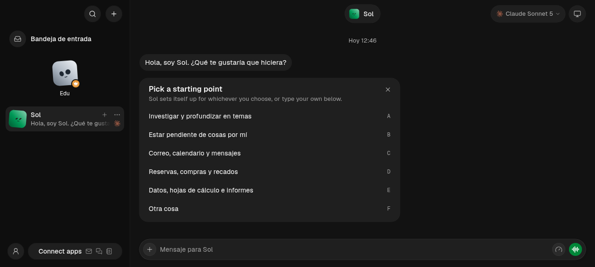

# Edu Bot

[English](README.md)

Edu Bot es una app de escritorio para Linux, Windows y macOS.
Conversas con varios bots de IA. Cada bot puede usar un motor que ya tienes.
Las conversaciones se quedan en tu computador. La app es de código abierto.



## Instalar

Descarga la **0.1.0** desde [GitHub Releases](https://github.com/EduardoMoraga/edu-bot/releases).

Estos instaladores no están firmados. El sistema pide confirmación antes de abrirlos.

**macOS** (Apple silicon o Intel): `EduBot-0.1.0-arm64.dmg` o `EduBot-0.1.0-x64.dmg`. El release también trae un `.zip` de la misma build.
Haz clic derecho en la app y elige Abrir.
Si macOS la bloquea, abre Configuración del Sistema, luego Privacidad y seguridad, y elige Abrir de todas formas.

**Windows** (64 bits): `EduBot-0.1.0-setup.exe`.
Si aparece SmartScreen, elige Más información y después Ejecutar de todas formas.

**Linux** (64 bits):

- AppImage: `chmod +x EduBot-0.1.0-x86_64.AppImage` y ejecuta ese archivo.
- Paquete deb: `sudo apt install ./EduBot-0.1.0-amd64.deb`.

Cada release incluye `SHA256SUMS`. Compara el archivo que descargaste con esa lista antes de abrirlo.

La app no se actualiza sola. Descarga el instalador nuevo desde Releases e instálalo del mismo modo. Tus chats siguen en `~/.edubot`.

## Primeros pasos

1. Entra a un motor en este computador. Edu Bot usa programas que ya tienes, por ejemplo `claude`, `codex` y Antigravity (`agy`, para Gemini). Hay más en Ajustes, en **Proveedores de modelos y cuentas**.
2. Crea un bot con **Bot nuevo**.
3. Conecta apps con tu propia clave de proyecto de Composio (empieza con `ak_`), o agrega tus servidores MCP. Sin clave, Apps explica los pasos. Mira [Conectar apps](docs/composio.md) y [servidores MCP propios](docs/custom-mcp-servers.md).
4. Agrega una conexión SQL de solo lectura en **Ajustes → Datos → Conexiones de datos**. Sirven SQLite, DuckDB y Postgres. La contraseña queda en la Bóveda. Un bot lee solo las tablas que tú permites.

## Memoria Edu

Instala [Edu](https://github.com/EduardoMoraga/edu) 6.0.0 o más nuevo (`npm install -g edu-agent`). Cada bot recibe entonces un cerebro Edu. Puede recordar notas y proponer otras.

Una nota canónica queda como propuesta hasta que una persona la acepta. Un bot no puede aprobarla. La app funciona igual si Edu no está instalado.

Edu crew deja que un bot pida a otras herramientas de código que armen un plan. Sigue apagado hasta que lo actives en ese bot. Tú apruebas cada plan.

Detalle: [cerebro Edu](docs/edu-brain.md).

## Perfiles de la organización

La organización, sus áreas y sus bots pueden vivir en archivos. Dos personas con la misma carpeta obtienen los mismos bots. Las claves se quedan en el computador de cada persona.

La app muestra un plan primero. Nada cambia hasta que lo aplicas. Una línea **Da más acceso** solo se aplica si tú la permites en la app de escritorio.

Ábrelo en **Ajustes → Perfiles**, o usa `edubot profiles plan` y `edubot profiles apply`.

Detalle: [Perfiles](docs/profiles.md).

## Privacidad

Edu Bot no envía analítica de uso. La app de escritorio no busca actualizaciones.

Una función contacta un servicio solo cuando la usas. La lista está en [Red](docs/edu-bot/network.md).

Los chats, los bots y los ajustes quedan en `~/.edubot`, en este computador. Mira [dónde viven los archivos](docs/edu-bot/data.md).

## Compilar desde el código

Necesitas Node.js 24 o más nuevo, y pnpm 10.33.0. Los dos están en `package.json`.

```sh
git clone https://github.com/EduardoMoraga/edu-bot.git
cd edu-bot
pnpm install
pnpm dev:server
pnpm dev
```

`pnpm dev:server` es el servidor local. `pnpm dev` es la app en el navegador. `pnpm dev:desktop` abre la ventana de escritorio. Deja el servidor corriendo.

`pnpm lint` revisa este checkout. [CI](docs/ci.md) dice qué tests corren.

Para colaborar, parte una rama desde `main` y abre un pull request en este repositorio.

## Licencia y créditos

Edu Bot es [Apache-2.0](LICENSE). Los avisos de copyright están en [NOTICE](NOTICE).

Edu Bot se basa en [OpenMausBot](https://github.com/milind-soni/OpenMausBot). Es un proyecto aparte. No está afiliado a Supamaus Software Private Limited ni al proyecto OpenMausBot.

Los programas de terceros dentro de los instaladores están en [binarios de terceros](docs/edu-bot/third-party-binaries.md).
