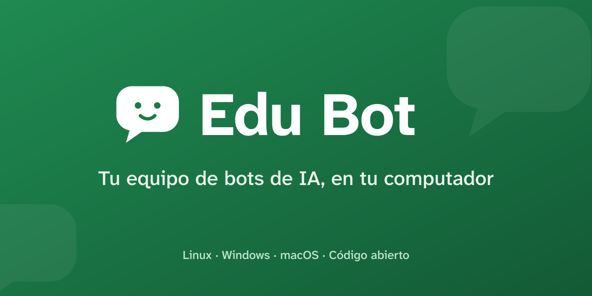
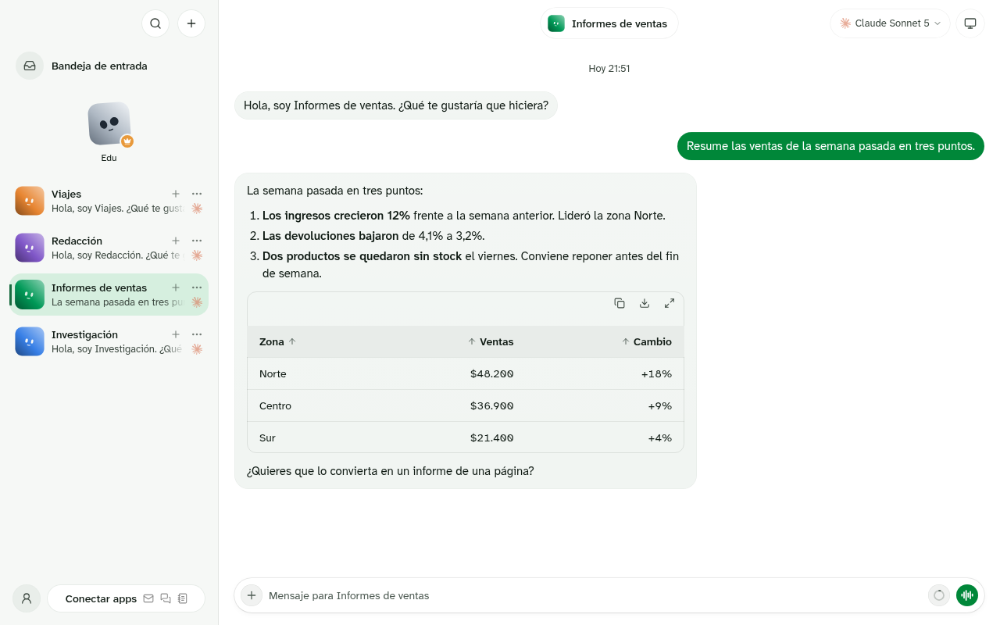
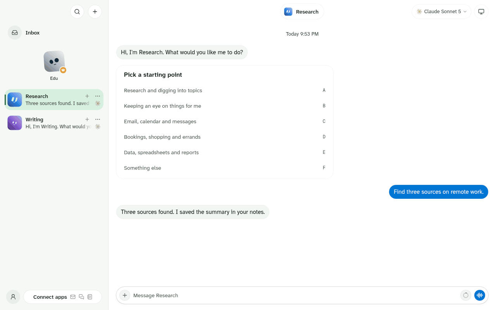
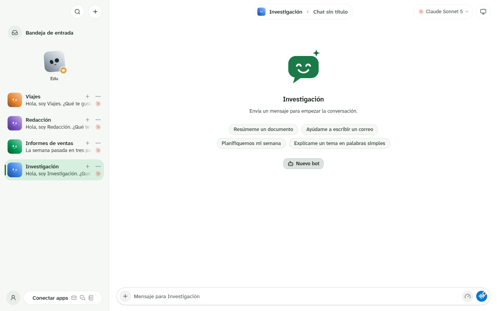
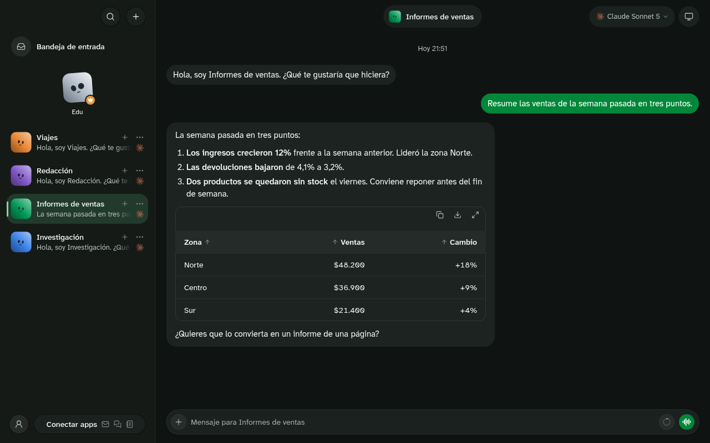
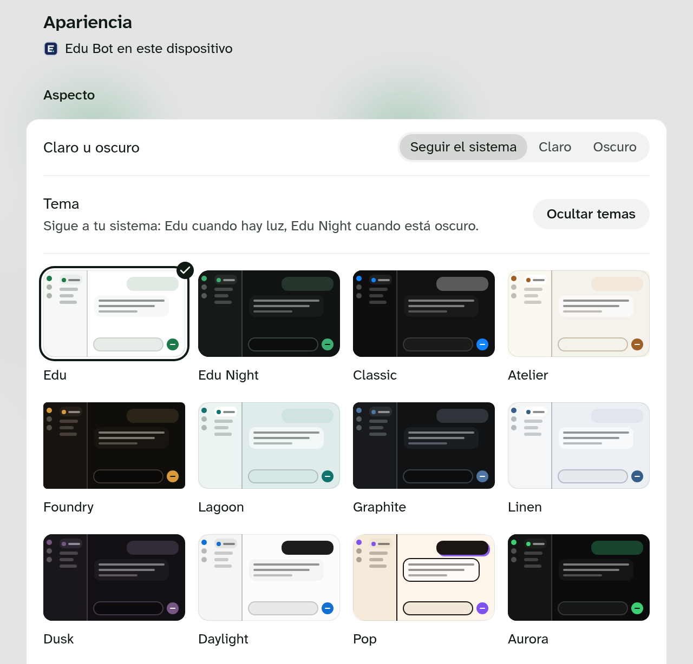
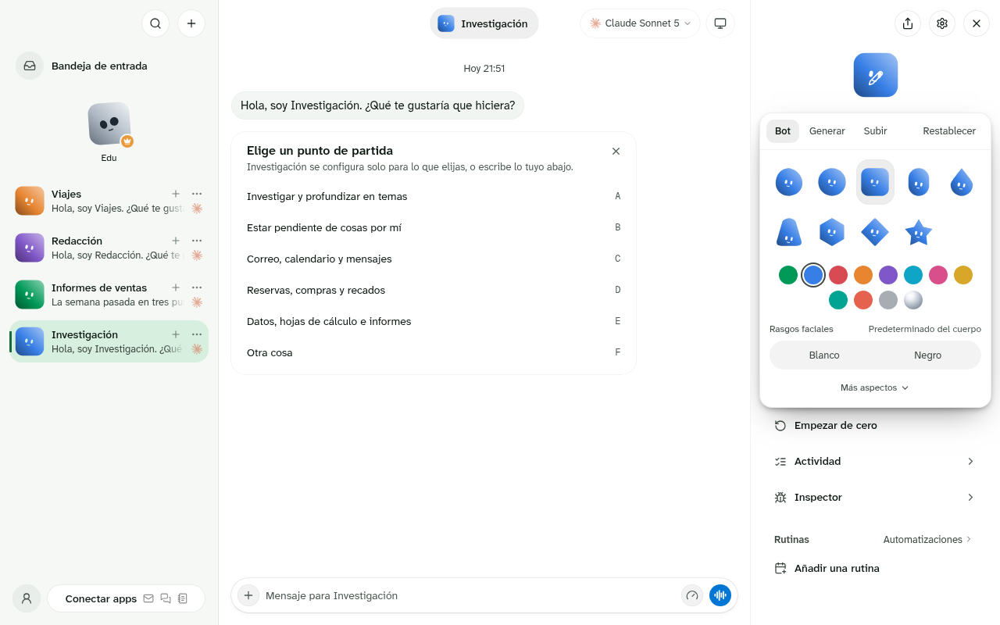
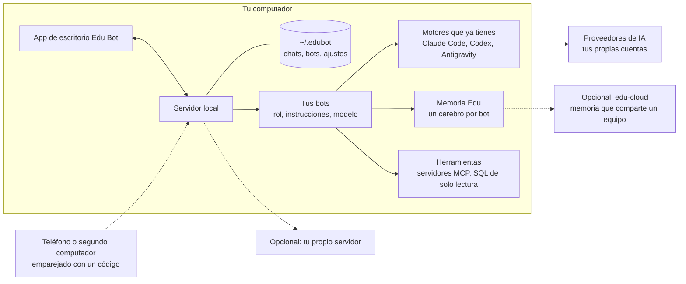

<p align="center">
  
</p>

<h1 align="center">Edu Bot</h1>

<p align="center"><strong>Tu equipo de bots de IA, en tu computador.</strong></p>

<p align="center">
  <a href="README.md">English</a>
</p>

<p align="center">
  <a href="https://github.com/EduardoMoraga/edu-bot/releases/latest"></a>
  <a href="https://github.com/EduardoMoraga/edu-bot/releases"></a>
  <a href="LICENSE"></a>
  <a href="https://github.com/EduardoMoraga/edu-bot/releases/latest"></a>
</p>

<p align="center">
  <a href="https://github.com/EduardoMoraga/edu-bot/releases/latest"></a>
  <a href="https://github.com/EduardoMoraga/edu-bot/releases/latest"></a>
  <a href="https://github.com/EduardoMoraga/edu-bot/releases/latest"></a>
</p>

<p align="center">
  Windows: <code>…-setup.exe</code> · macOS: <code>…-arm64.dmg</code> (Apple silicon) o <code>…-x64.dmg</code> (Intel) · Linux: <code>….AppImage</code> o <code>….deb</code>
</p>

Edu Bot es una app de escritorio de código abierto para Linux, Windows y macOS.
Conversas con un equipo de bots de IA. Cada bot tiene su propia tarea.
Cada bot usa un motor de IA que ya tienes, como Claude Code, Codex o Gemini.
Tus conversaciones se quedan en tu computador.



## Míralo funcionar

Elige un aspecto, crea un bot, pregunta y lee la respuesta.



## Qué obtienes

| | |
| --- | --- |
| **Un equipo de bots.** Cada bot tiene nombre, cara, sus propias instrucciones y su propio modelo. | **Tus propios motores.** Los bots usan herramientas que ya tienes: Claude Code, Codex, Antigravity (Gemini) y [más](docs/custom-engines.md). |
| **Primero local.** Los chats, los bots y los ajustes quedan en `~/.edubot`. Sin analítica de uso. | **Memoria Edu.** Cada bot puede recordar notas y proponer otras. Una persona aprueba lo que queda. |
| **Tus apps.** Conecta Notion, Linear, Atlassian, GitHub o tu propio servidor MCP. | **Números reales.** Un bot lee tus datos de SQLite, DuckDB o Postgres. Solo lectura. Solo las tablas que tú permites. |
| **Bots en archivos.** La organización, sus áreas y sus bots pueden vivir en una carpeta que compartes. | **Tu aspecto.** Doce temas. Edu de día, Edu Night de noche. |

## Descargar e instalar

Baja la versión más nueva desde [GitHub Releases](https://github.com/EduardoMoraga/edu-bot/releases/latest).

Estos instaladores no están firmados. El sistema pide confirmación antes de abrirlos.

**macOS** (Apple silicon o Intel): el archivo que termina en `-arm64.dmg` o en `-x64.dmg`. La misma versión también trae un `.zip` de la misma compilación.
Arrastra la app del `.dmg` a Aplicaciones.
Ábrela una vez. macOS la bloquea.
Luego abre Configuración del Sistema, luego Privacidad y seguridad, y elige Abrir de todas formas.

**Windows** (64 bits): el archivo que termina en `-setup.exe`.
Si aparece SmartScreen, elige Más información y después Ejecutar de todas formas.

**Linux** (64 bits):

- AppImage: el archivo que termina en `-x86_64.AppImage`. Dale permiso con `chmod +x` y ejecuta ese archivo.
- Paquete deb: el archivo que termina en `-amd64.deb`. Instálalo con `sudo apt install ./<archivo>.deb`.

Cada versión incluye `SHA256SUMS`. Compara el archivo que descargaste con esa lista antes de abrirlo.

Desde la 0.2.0 la app se actualiza sola en Windows y Linux.
En Mac, y para pasar desde la 0.1.0, descarga el instalador nuevo desde la misma página e instálalo del mismo modo.
Tus chats siguen en `~/.edubot`.

## Primeros pasos en 3 pasos

1. **Inicia sesión en un motor.** Edu Bot usa programas que ya tienes, por ejemplo `claude`, `codex` y Antigravity (`agy`, para Gemini). Hay más en **Ajustes → IA → Proveedores**. Claude usa tu propio Claude Code: inicia sesión con `claude auth login`. Edu Bot nunca lee ni guarda los tokens de Claude y no consulta la API de uso de Anthropic.
2. **Crea un bot.** Pulsa **Bot nuevo**.
3. **Pregunta.** Escribe lo que necesitas. La respuesta aparece en el chat.

Después, cuando quieras más:

- **Conecta apps.** Abre Apps. Pulsa Conectar en Notion, Linear o Atlassian e inicia sesión en tu navegador. Para GitHub, pega un token. Para tu propio servidor MCP, pega su enlace. Gmail, Google Calendar y Slack necesitan tu propia clave de proyecto de Composio (empieza con `ak_`): Apps la pide en Más apps. Mira [Conectar apps](docs/composio.md) y [servidores MCP propios](docs/custom-mcp-servers.md).
- **Agrega tus datos.** En Ajustes, activa el **Modo avanzado**, o busca **Datos**. Luego agrega una conexión SQL de solo lectura en **Ajustes → Datos → Conexiones de datos**. Sirven SQLite, DuckDB y Postgres. La contraseña queda en la Bóveda. Por una conexión, un bot lee solo las tablas que tú permites: ese es el límite firme. Las herramientas de datos locales del bot pueden leer otros archivos a los que el bot llega, igual que su terminal. Rechazan el archivo de base de datos de una conexión, una carpeta permitida para conexiones y la carpeta de datos de Edu Bot, también a través de un enlace, y rechazan una carpeta demasiado grande para revisarla.
- **Usa un teléfono o un segundo computador.** Emparéjalo en **Ajustes → Teléfono y dispositivos**. Mira [más de un dispositivo](docs/multi-device.md).

## Galería

| | |
| --- | --- |
|  |  |
| Un chat nuevo, con ideas para empezar. | Edu Night, para la noche. |
|  |  |
| Doce temas, un clic. | Cada bot tiene su propia cara. |

## Cómo funciona

Todo lo que está en la caja grande corre en tu computador.



- La **app de escritorio** es la ventana que ves. Habla con un **servidor local** en el mismo computador.
- Un **bot** es un rol: sus instrucciones, su modelo y las herramientas que puede usar.
- Un **motor** es el programa que piensa, con tu propia cuenta. Mira [motores](docs/custom-engines.md).
- La **memoria Edu** es opcional. Mira [Memoria Edu](#memoria-edu).
- Un **teléfono** o un **segundo computador** puede abrir los mismos bots. Mira [más de un dispositivo](docs/multi-device.md).
- Puedes mover los bots a [un servidor tuyo](docs/self-hosting.md). Edu Bot no tiene un servicio de nube propio.

## Cómo se compara

Edu Bot no reemplaza tus herramientas de IA. Las usa por ti, como un equipo.

| | Edu Bot | Un sitio de chat | Una CLI de código |
| --- | --- | --- | --- |
| Dónde lo usas | Una app de escritorio | Una pestaña del navegador | Una terminal |
| Dónde viven tus chats | En tu computador | En los servidores del proveedor | En tu computador |
| Qué IA | Los motores que ya tienes. Uno por bot. | Los modelos de ese proveedor | Los modelos de esa herramienta |
| Varios bots, cada uno con su tarea | Sí | Depende del producto | Normalmente una sesión a la vez |
| Costo | Gratis y de código abierto. Tú pagas tus propios planes de IA. | El plan del proveedor | El plan de la herramienta |

## Memoria Edu

Instala [Edu](https://github.com/EduardoMoraga/edu) 6.0.0 o más nuevo. Necesita Node.js 22 o más nuevo. Edu no está en el registro de npm: instala su archivo de versión verificado.

```bash
curl -fsSLO https://github.com/EduardoMoraga/edu/releases/latest/download/edu-agent.tgz
curl -fsSLO https://github.com/EduardoMoraga/edu/releases/latest/download/SHA256SUMS
sha256sum --check --ignore-missing SHA256SUMS   # en macOS: shasum -a 256 --check --ignore-missing SHA256SUMS
npm install -g ./edu-agent.tgz
```

En Windows, usa el instalador de una línea de la [guía rápida de Edu](https://github.com/EduardoMoraga/edu#quickstart). Cada bot recibe entonces un cerebro Edu. Puede recordar notas y proponer otras.

Una nota canónica queda como propuesta hasta que una persona la acepta. En el uso normal, la app impide que un bot la apruebe: cada motor corre con la protección de trabajador de crew de Edu. Un bot con terminal podría quitar esa protección, así que el límite firme necesita un secreto de aprobación en el propio Edu; es una mejora planeada de Edu. La app funciona igual si Edu no está instalado.

Edu crew deja que un bot pida a otras herramientas de código que armen un plan. Sigue apagado hasta que lo actives en ese bot. Tú apruebas cada plan.

Detalle: [cerebro Edu](docs/edu-brain.md).

## Perfiles de la organización

La organización, sus áreas y sus bots pueden vivir en archivos. Dos personas con la misma carpeta obtienen los mismos bots. Las claves se quedan en el computador de cada persona.

La app muestra un plan primero. Nada cambia hasta que lo aplicas. Una línea **Da más acceso** solo se aplica si tú la permites en la app de escritorio.

Ábrelo en **Ajustes → Perfiles**. En una copia local, ejecuta `pnpm omb profiles plan <carpeta>` y `pnpm omb profiles apply <carpeta>`.

Detalle: [Perfiles](docs/profiles.md).

## Privacidad

Edu Bot no envía analítica de uso. En Windows y Linux la app de escritorio busca actualizaciones en las versiones de este repositorio; en Mac no.

Al iniciar, Edu Bot consulta unas listas públicas de modelos y de versiones. Un motor que ya instalaste puede llamar a su propio servicio en ese momento. Cualquier otro contacto ocurre solo cuando usas esa función. La lista está en [Red](docs/edu-bot/network.md).

Los chats, los bots y los ajustes quedan en `~/.edubot`, en este computador. Mira [dónde viven los archivos](docs/edu-bot/data.md).

## Compilar desde el código

Necesitas Node.js 24 o más nuevo, y pnpm 10.33.0. Los dos están en `package.json`.

```sh
git clone https://github.com/EduardoMoraga/edu-bot.git
cd edu-bot
pnpm install
```

Ejecuta `pnpm dev:server` en una terminal y `pnpm dev` en otra. Deja las dos corriendo.

`pnpm dev:server` es el servidor local. `pnpm dev` es la app en el navegador. `pnpm dev:desktop` abre la ventana de escritorio, y necesita que las dos estén corriendo. La primera vez descarga Electron si falta y, en macOS y Windows, el driver con el que los bots usan este equipo. En Mac, permite Electron (o la terminal desde la que lo iniciaste) en Accesibilidad y Grabación de pantalla.

`pnpm lint` revisa tu copia local. [CI](docs/ci.md) dice qué tests corren.

Para colaborar, crea una rama desde `main` y abre un pull request en este repositorio.

## Licencia y créditos

Edu Bot es [Apache-2.0](LICENSE). Los avisos de copyright están en [NOTICE](NOTICE).

Edu Bot se basa en [OpenMausBot](https://github.com/milind-soni/OpenMausBot). Es un proyecto aparte. No está afiliado a Supamaus Software Private Limited ni al proyecto OpenMausBot.

Los programas de terceros dentro de los instaladores están en [binarios de terceros](docs/edu-bot/third-party-binaries.md).

<p align="center">
  <picture>
    <source media="(prefers-color-scheme: dark)" srcset="docs/images/wordmark-dark.svg">
    
  </picture>
</p>
