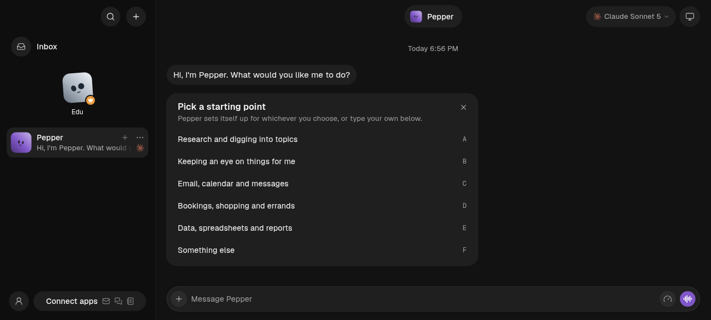

# Edu Bot

[Español](README.es.md)

Edu Bot is a desktop app for Linux, Windows, and macOS.
You chat with a roster of AI bots. Each bot can use an engine you already have.
Your chats stay on this computer. The app is open source.



## Install

Download **0.1.0** from [GitHub Releases](https://github.com/EduardoMoraga/edu-bot/releases).

These installers are not signed. Your system asks before it opens them.

**macOS** (Apple silicon or Intel): `EduBot-0.1.0-arm64.dmg` or `EduBot-0.1.0-x64.dmg`. A `.zip` of the same build is on the release too.
Drag the app from the `.dmg` into Applications.
Open the app once. macOS blocks it.
Then open System Settings, then Privacy & Security, then Open Anyway.

**Windows** (64-bit): `EduBot-0.1.0-setup.exe`.
If SmartScreen appears, choose More info, then Run anyway.

**Linux** (64-bit):

- AppImage: `chmod +x EduBot-0.1.0-x86_64.AppImage`, then run that file.
- Debian package: `sudo apt install ./EduBot-0.1.0-amd64.deb`.

Each release includes `SHA256SUMS`. Compare the file you downloaded with that list before you open it.

From 0.2.0 the app updates itself on Windows and Linux. On a Mac, and to move from 0.1.0, download the newer installer from Releases and install it the same way. Your chats stay in `~/.edubot`.

## First steps

1. Sign in to an engine on this computer. Edu Bot runs CLIs you already have, for example `claude`, `codex`, and Antigravity (`agy`, for Gemini). More engines are in **Settings → AI → Providers**. Claude uses your own Claude Code: sign in with `claude auth login`. Edu Bot never reads or saves Claude's tokens and does not call Anthropic's usage API.
2. Create a bot with **New bot**.
3. Open Apps. Press Connect on Notion, Linear or Atlassian and sign in in your browser. For GitHub, paste a token. For your own MCP server, paste its link. Gmail, Google Calendar and Slack need your own Composio project key (it starts with `ak_`): Apps asks for it under More apps. See [Connect apps](docs/composio.md) and [your own MCP servers](docs/custom-mcp-servers.md).
4. In Settings, turn on **Advanced mode**, or search for **Data**. Then add a read-only SQL connection in **Settings → Data → Data connections**. SQLite, DuckDB, and Postgres work. The password stays in the Vault. Through a connection, a bot reads only the tables you allow: that is the hard limit. The bot's local data tools can read other files the bot can reach, as its terminal can. They refuse a connection's database file, a folder allowed for connections, and Edu Bot's own data folder, also through a link, and they refuse a folder too large to check.

## Edu memory

Install [Edu](https://github.com/EduardoMoraga/edu) 6.0.0 or newer. It needs Node.js 22 or newer. Edu is not on the npm registry: install its verified release file.

```bash
curl -fsSLO https://github.com/EduardoMoraga/edu/releases/latest/download/edu-agent.tgz
curl -fsSLO https://github.com/EduardoMoraga/edu/releases/latest/download/SHA256SUMS
sha256sum --check --ignore-missing SHA256SUMS   # macOS: shasum -a 256 --check --ignore-missing SHA256SUMS
npm install -g ./edu-agent.tgz
```

On Windows, use the one-line installer in [Edu's quickstart](https://github.com/EduardoMoraga/edu#quickstart). Each bot then gets an Edu brain. It can recall notes and propose new ones.

A canonical note stays a proposal until a person accepts it. In normal use the app stops a bot from approving one: every engine runs with Edu's crew-worker guard. A bot with a terminal could remove that guard, so the hard limit needs an approval secret in Edu itself; that is a planned Edu improvement. The app still runs if Edu is missing.

Edu crew lets a bot ask other coding tools to plan work. It stays off until you turn it on for that bot. You approve each plan.

Details: [Edu brain](docs/edu-brain.md).

## Organisation profiles

An organisation, its areas, and its bots can live in files. Two people with the same folder get the same bots. Keys stay on each person's computer.

The app shows a plan first. Nothing changes until you apply it. A line marked **Gives more access** applies only after you allow it in the desktop app.

Open **Settings → Profiles**. From the command line, run `edubot profiles plan <folder>` and `edubot profiles apply <folder>`.

Details: [Profiles](docs/profiles.md).

## Privacy

Edu Bot sends no usage analytics. On Windows and Linux the desktop app checks this repository's releases for updates; on macOS it does not.

At start, Edu Bot looks up a few public model and version lists. An engine you already installed may call its own service then. Anything else is contacted only when you use that feature. The list is in [Network](docs/edu-bot/network.md).

Chats, bots, and settings stay in `~/.edubot` on this computer. See [where the files live](docs/edu-bot/data.md).

## Build from source

You need Node.js 24 or newer and pnpm 10.33.0. `package.json` names both.

```sh
git clone https://github.com/EduardoMoraga/edu-bot.git
cd edu-bot
pnpm install
```

Run `pnpm dev:server` in one terminal and `pnpm dev` in another. Leave both running.

`pnpm dev:server` is the local server. `pnpm dev` is the app in a browser. `pnpm dev:desktop` opens the desktop window, and it needs both of those running. The first time, it downloads Electron if it is missing and, on macOS and Windows, the driver that lets bots use this computer. On a Mac, allow Electron (or the terminal you started it from) under Accessibility and Screen Recording.

`pnpm lint` checks this checkout. [CI](docs/ci.md) says which tests run.

To contribute, branch from `main` and open a pull request on this repository.

## Licence and credits

Edu Bot is [Apache-2.0](LICENSE). Copyright lines are in [NOTICE](NOTICE).

Edu Bot is based on [OpenMausBot](https://github.com/milind-soni/OpenMausBot). It is a separate project. It is not affiliated with Supamaus Software Private Limited or the OpenMausBot project.

Third-party programs inside the installers are listed in [third-party binaries](docs/edu-bot/third-party-binaries.md).
