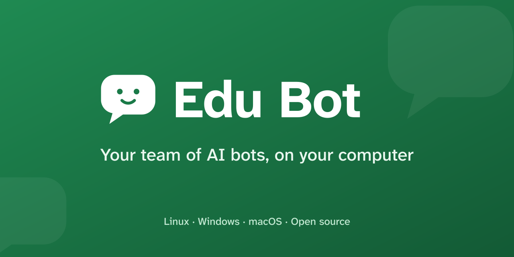
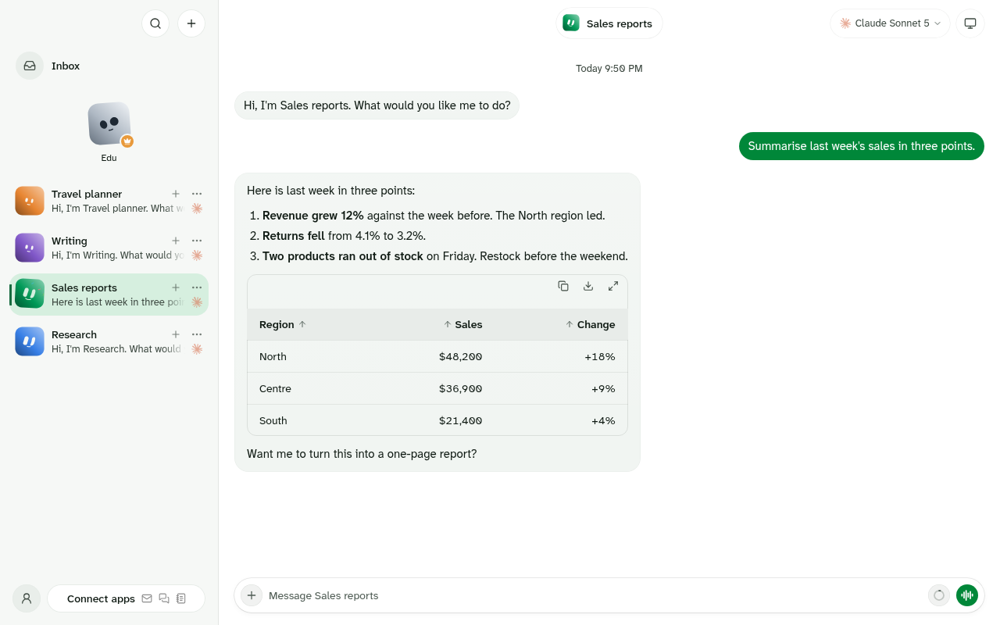
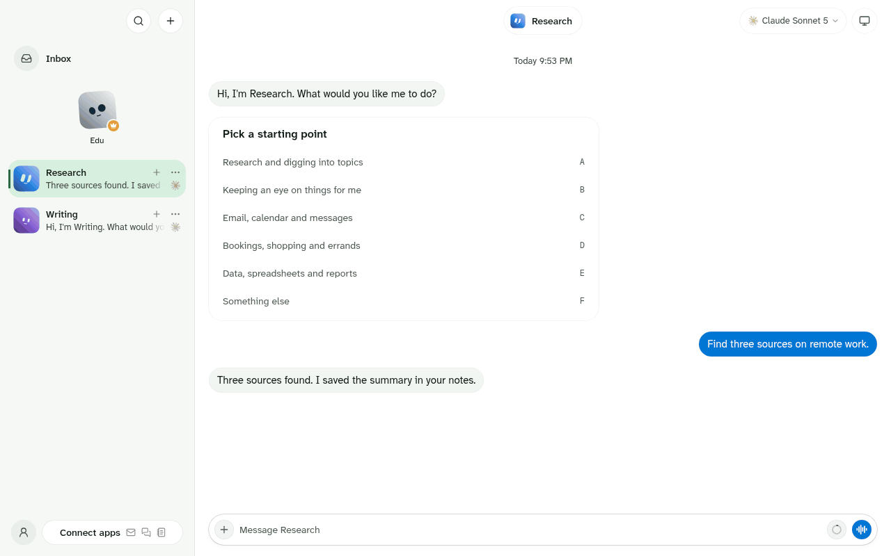
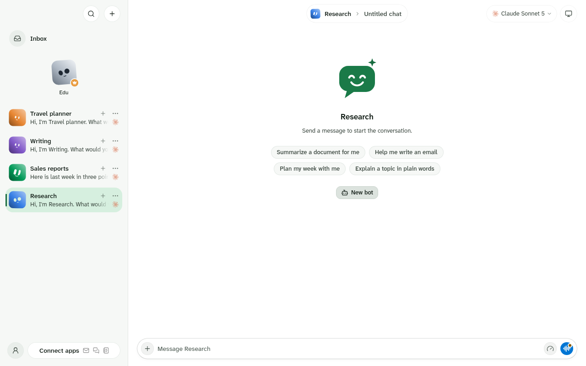
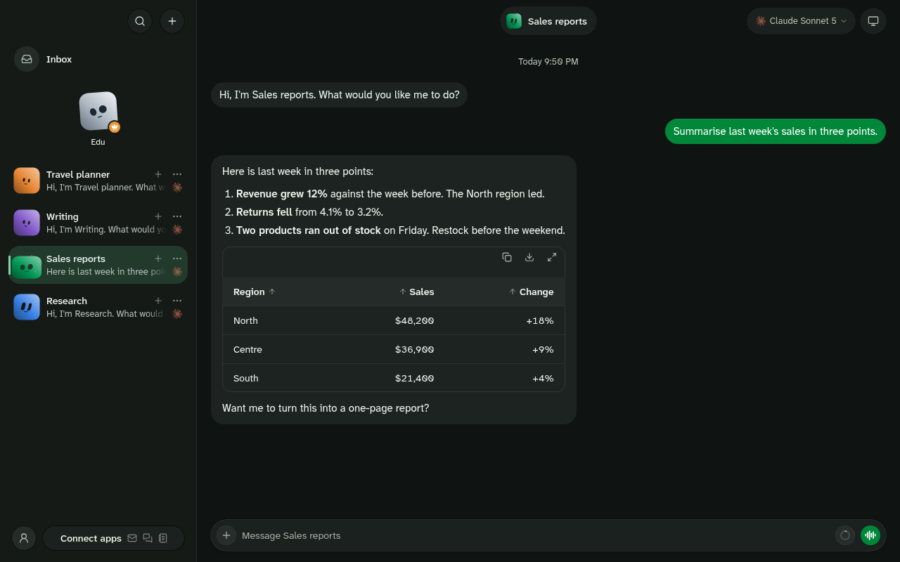
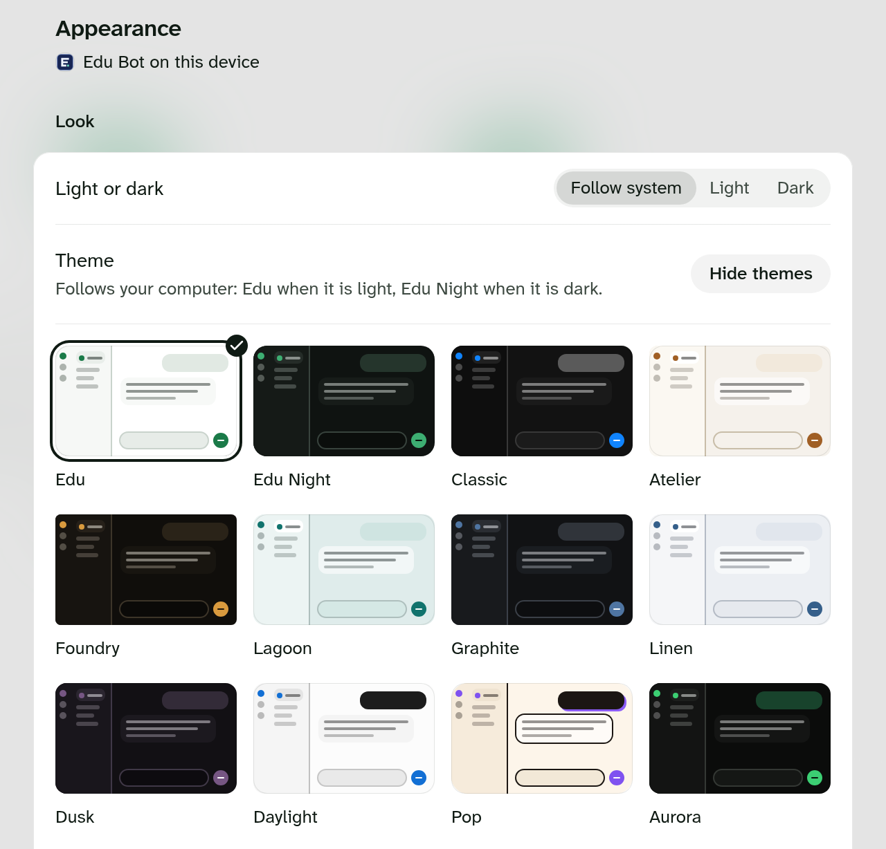
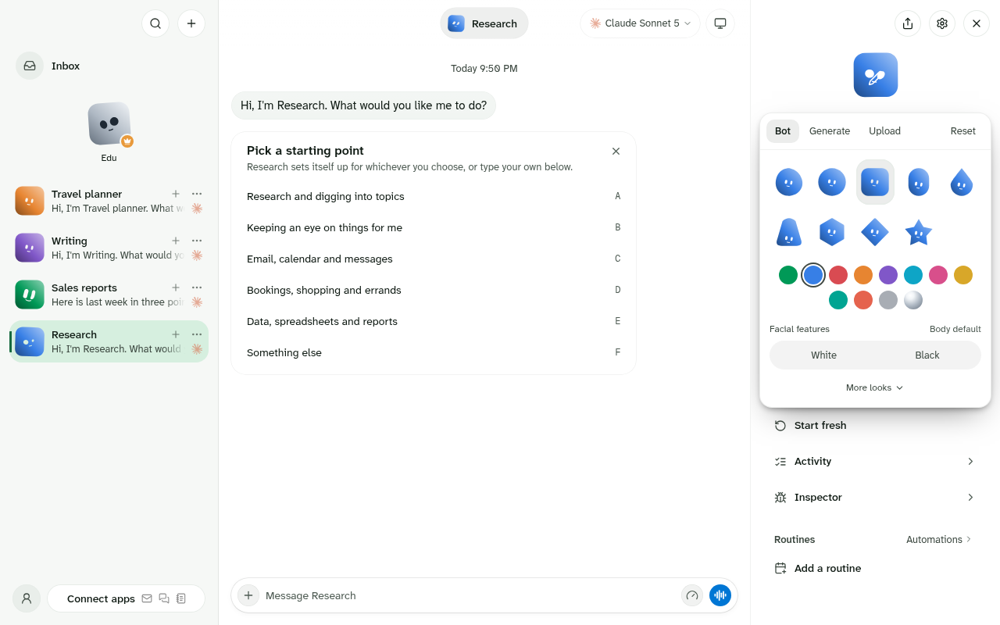
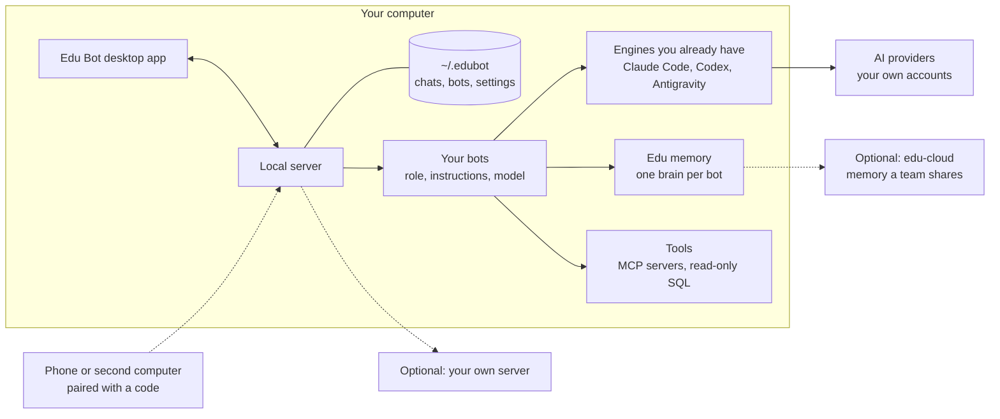

<p align="center">
  
</p>

<h1 align="center">Edu Bot</h1>

<p align="center"><strong>Your team of AI bots, on your computer.</strong></p>

<p align="center">
  <a href="README.es.md">Español</a>
</p>

<p align="center">
  <a href="https://github.com/EduardoMoraga/edu-bot/releases/latest"></a>
  <a href="https://github.com/EduardoMoraga/edu-bot/releases"></a>
  <a href="LICENSE"></a>
  <a href="https://github.com/EduardoMoraga/edu-bot/releases/latest"></a>
</p>

<p align="center">
  <a href="https://github.com/EduardoMoraga/edu-bot/releases/latest"></a>
  <a href="https://github.com/EduardoMoraga/edu-bot/releases/latest"></a>
  <a href="https://github.com/EduardoMoraga/edu-bot/releases/latest"></a>
</p>

<p align="center">
  Windows: <code>…-setup.exe</code> · macOS: <code>…-arm64.dmg</code> (Apple silicon) or <code>…-x64.dmg</code> (Intel) · Linux: <code>….AppImage</code> or <code>….deb</code>
</p>

Edu Bot is an open-source desktop app for Linux, Windows, and macOS.
You chat with a team of AI bots. Each bot has its own job.
Each bot uses an AI engine you already have, like Claude Code, Codex, or Gemini.
Your chats stay on this computer.



## See it work

Pick a look, make a new bot, ask, and read the answer.



## What you get

| | |
| --- | --- |
| **A team of bots.** Each bot has a name, a face, its own instructions, and its own model. | **Your own engines.** Bots run on tools you already have: Claude Code, Codex, Antigravity (Gemini), and [more](docs/custom-engines.md). |
| **Local first.** Chats, bots, and settings stay in `~/.edubot`. No usage analytics. | **Edu memory.** Each bot can recall notes and propose new ones. A person approves what stays. |
| **Your apps.** Connect Notion, Linear, Atlassian, GitHub, or your own MCP server. | **Real numbers.** A bot reads your SQLite, DuckDB, or Postgres data. Read only. Only the tables you allow. |
| **Bots in files.** An organisation, its areas, and its bots can live in a folder you share. | **Your look.** Twelve themes. Edu by day, Edu Night after dark. |

## Download and install

Get the newest version from [GitHub Releases](https://github.com/EduardoMoraga/edu-bot/releases/latest).

These installers are not signed. Your system asks before it opens them.

**macOS** (Apple silicon or Intel): the file that ends in `-arm64.dmg` or `-x64.dmg`. A `.zip` of the same build is on the release too.
Drag the app from the `.dmg` into Applications.
Open the app once. macOS blocks it.
Then open System Settings, then Privacy & Security, then Open Anyway.

**Windows** (64-bit): the file that ends in `-setup.exe`.
If SmartScreen appears, choose More info, then Run anyway.

**Linux** (64-bit):

- AppImage: the file that ends in `-x86_64.AppImage`. Run `chmod +x` on it, then run that file.
- Debian package: the file that ends in `-amd64.deb`. Install it with `sudo apt install ./<file>.deb`.

Each release includes `SHA256SUMS`. Compare the file you downloaded with that list before you open it.

From 0.2.0 the app updates itself on Windows and Linux.
On a Mac, and to move from 0.1.0, download the newer installer from Releases and install it the same way.
Your chats stay in `~/.edubot`.

## Get started in 3 steps

1. **Sign in to an engine.** Edu Bot runs CLIs you already have, for example `claude`, `codex`, and Antigravity (`agy`, for Gemini). More engines are in **Settings → AI → Providers**. Claude uses your own Claude Code: sign in with `claude auth login`. Edu Bot never reads or saves Claude's tokens and does not call Anthropic's usage API.
2. **Create a bot.** Press **New bot**.
3. **Ask.** Type what you need. The answer appears in the chat.

Then, when you want more:

- **Connect apps.** Open Apps. Press Connect on Notion, Linear or Atlassian and sign in in your browser. For GitHub, paste a token. For your own MCP server, paste its link. Gmail, Google Calendar and Slack need your own Composio project key (it starts with `ak_`): Apps asks for it under More apps. See [Connect apps](docs/composio.md) and [your own MCP servers](docs/custom-mcp-servers.md).
- **Add your data.** In Settings, turn on **Advanced mode**, or search for **Data**. Then add a read-only SQL connection in **Settings → Data → Data connections**. SQLite, DuckDB, and Postgres work. The password stays in the Vault. Through a connection, a bot reads only the tables you allow: that is the hard limit. The bot's local data tools can read other files the bot can reach, as its terminal can. They refuse a connection's database file, a folder allowed for connections, and Edu Bot's own data folder, also through a link, and they refuse a folder too large to check.
- **Use a phone or a second computer.** Pair it in **Settings → Phone & devices**. See [more than one device](docs/multi-device.md).

## Gallery

| | |
| --- | --- |
|  |  |
| A new chat, with ideas to start. | Edu Night, for the dark. |
|  |  |
| Twelve themes, one click. | Each bot gets its own face. |

## How it works

Everything in the big box runs on your computer.



- The **desktop app** is the window you see. It talks to a **local server** on the same computer.
- A **bot** is a role: its instructions, its model, and the tools it may use.
- An **engine** is the program that does the thinking, with your own account. See [engines](docs/custom-engines.md).
- **Edu memory** is optional. See [Edu memory](#edu-memory).
- A **phone** or a **second computer** can open the same bots. See [more than one device](docs/multi-device.md).
- You can move the bots to [a server you run](docs/self-hosting.md). Edu Bot has no cloud service of its own.

## How it compares

Edu Bot does not replace your AI tools. It runs them for you, as a team.

| | Edu Bot | A chat website | A coding CLI |
| --- | --- | --- | --- |
| Where you use it | A desktop app | A browser tab | A terminal |
| Where your chats live | On your computer | On the provider's servers | On your computer |
| Which AI | The engines you already have. One per bot. | That provider's models | That tool's models |
| Many bots, each with its own job | Yes | Depends on the product | Usually one session at a time |
| Cost | Free and open source. You pay for your own AI plans. | The provider's plan | The tool's plan |

## Edu memory

Install [Edu](https://github.com/EduardoMoraga/edu) 6.0.0 or newer. It needs Node.js 22 or newer. Edu is not on the npm registry: install its verified release file.

```bash
curl -fsSLO https://github.com/EduardoMoraga/edu/releases/latest/download/edu-agent.tgz
curl -fsSLO https://github.com/EduardoMoraga/edu/releases/latest/download/SHA256SUMS
sha256sum --check --ignore-missing SHA256SUMS   # macOS: shasum -a 256 --check --ignore-missing SHA256SUMS
npm install -g ./edu-agent.tgz
```

On Windows, use the one-line installer in [Edu's quickstart](https://github.com/EduardoMoraga/edu#quickstart). Each bot then gets an Edu brain. It can recall notes and propose new ones.

A canonical note stays a proposal until a person accepts it. In normal use the app stops a bot from approving one: every engine runs with Edu's crew-worker guard. A bot with a terminal could remove that guard, so the hard limit needs an approval secret in Edu itself; that is a planned Edu improvement. The app still runs if Edu is missing.

Edu crew lets a bot ask other coding tools to plan work. It stays off until you turn it on for that bot. You approve each plan.

Details: [Edu brain](docs/edu-brain.md).

## Organisation profiles

An organisation, its areas, and its bots can live in files. Two people with the same folder get the same bots. Keys stay on each person's computer.

The app shows a plan first. Nothing changes until you apply it. A line marked **Gives more access** applies only after you allow it in the desktop app.

Open **Settings → Profiles**. From the command line, run `edubot profiles plan <folder>` and `edubot profiles apply <folder>`.

Details: [Profiles](docs/profiles.md).

## Privacy

Edu Bot sends no usage analytics. On Windows and Linux the desktop app checks this repository's releases for updates; on macOS it does not.

At start, Edu Bot looks up a few public model and version lists. An engine you already installed may call its own service then. Anything else is contacted only when you use that feature. The list is in [Network](docs/edu-bot/network.md).

Chats, bots, and settings stay in `~/.edubot` on this computer. See [where the files live](docs/edu-bot/data.md).

## Build from source

You need Node.js 24 or newer and pnpm 10.33.0. `package.json` names both.

```sh
git clone https://github.com/EduardoMoraga/edu-bot.git
cd edu-bot
pnpm install
```

Run `pnpm dev:server` in one terminal and `pnpm dev` in another. Leave both running.

`pnpm dev:server` is the local server. `pnpm dev` is the app in a browser. `pnpm dev:desktop` opens the desktop window, and it needs both of those running. The first time, it downloads Electron if it is missing and, on macOS and Windows, the driver that lets bots use this computer. On a Mac, allow Electron (or the terminal you started it from) under Accessibility and Screen Recording.

`pnpm lint` checks this checkout. [CI](docs/ci.md) says which tests run.

To contribute, branch from `main` and open a pull request on this repository.

## Licence and credits

Edu Bot is [Apache-2.0](LICENSE). Copyright lines are in [NOTICE](NOTICE).

Edu Bot is based on [OpenMausBot](https://github.com/milind-soni/OpenMausBot). It is a separate project. It is not affiliated with Supamaus Software Private Limited or the OpenMausBot project.

Third-party programs inside the installers are listed in [third-party binaries](docs/edu-bot/third-party-binaries.md).

<p align="center">
  <picture>
    <source media="(prefers-color-scheme: dark)" srcset="docs/images/wordmark-dark.svg">
    
  </picture>
</p>
